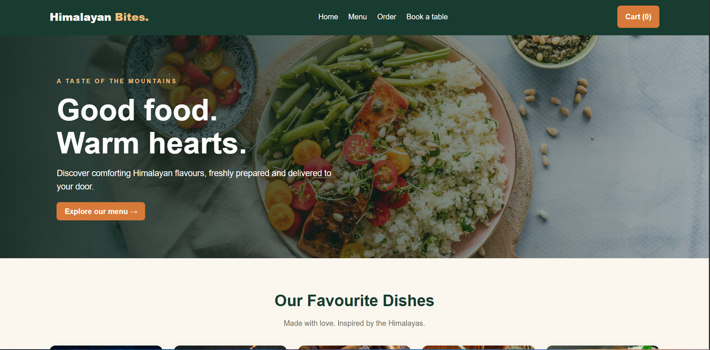

# 🏔️ Himalayan Bites 🍜

A full-stack restaurant website built to make online food ordering simple and convenient. Browse the menu, add dishes to your cart, and place orders through a website powered by Node.js, Express.js, and MySQL.

**Built with:** HTML · CSS · JavaScript · Node.js · Express.js · MySQL

## ✨ Features

- 🍽️ Browse the restaurant menu
- 🛒 Add food items to a shopping cart
- 🧾 Proceed to checkout and submit an order
- 🗄️ Store orders and order items in MySQL
- ⚙️ Handle backend requests using Node.js and Express.js
- 📱 Use the website on different screen sizes

## 🛠️ Technologies Used


- **Frontend:** HTML5, CSS3, JavaScript
- **Backend:** Node.js, Express.js
- **Database:** MySQL
- **Database Driver:** mysql2
- **Environment Configuration:** dotenv
- **Version Control:** Git and GitHub


## 📁 Project Structure

```text

himalayan-bites/
├── public/
│   ├── css/
│   ├── images/
│   ├── js/
│   ├── index.html
│   ├── menu.html
│   ├── cart.html
│   ├── checkout.html
│   └── orders.html
├── server/
│   └── db.js
├── Screenshots/
│   └── homepage.png.png
├── .env                 # Local environment variables (not committed)
├── .gitignore
├── package.json
├── package-lock.json
├── server.js
└── README.md

```

## ⚙️ Run Locally

### Prerequisites

- Node.js and npm
- MySQL Server
- Git (optional, for cloning the repository)

### 1. Clone the repository

```bash
git clone https://github.com/BOCCHI580/Himalayan-Bites.git
cd Himalayan-Bites
```

### 2. Install dependencies

```bash
npm install
```

### 3. Configure environment variables

Create a `.env` file in the project root:

```env
DB_HOST=localhost
DB_PORT=3306
DB_USER=root
DB_PASSWORD=your_mysql_password
DB_NAME=himalayan_bites_db
```

Replace `your_mysql_password` with your own local MySQL password. **Never commit your real `.env` file to GitHub.**

### 4. Set up the database


Create a MySQL database named `himalayan_bites_db`. Make sure these tables exist before running the website:

- `menu_items` — stores restaurant menu items
- `orders` — stores customer orders
- `order_items` — stores the items in each order
- `table_bookings` — stores table booking information

Configure the database connection using the `.env` example above. Use your own local MySQL credentials, and never upload your real `.env` file to GitHub.


Add your own menu items to the `menu_items` table before testing orders.

### 5. Start the server

```bash
npm start
```

Open [http://localhost:3000](http://localhost:3000) in your browser.

## 🔌 API Endpoint


- **`GET /api/health`** — Checks whether the backend server is running.
- **`POST /api/orders`** — Accepts a customer delivery order and saves the order information to MySQL.


## 🚧 Future Improvements

- Restaurant table booking
- Order history and status tracking
- Improved validation and error handling
- Online deployment
- Screenshots and a live demo link

## 👨‍💻 Project Purpose

Built as a personal and college portfolio project to practise frontend development, backend APIs, database integration, and version control.

---

## Screenshots

### Homepage



**Note:** This project currently runs locally. Online ordering requires the server and database to be hosted before it can accept orders from public visitors.
